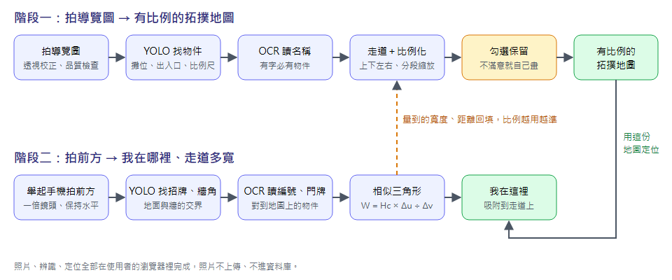

# PhotoPath × `.phop` 企劃書 v0.2
**拍一張導覽圖，就知道自己在哪裡**

| 項目 | 內容 |
|---|---|
| 文件版本 | v0.2（方向重整版，取代 v0.1） |
| 日期 | 2026-11-19 |
| 舊版 | [docs/封存/PhotoPath_phop企劃書_v0.1.md](docs/封存/PhotoPath_phop企劃書_v0.1.md) |
| 變更日誌 | [docs/changelog/變更日誌.md](docs/changelog/變更日誌.md)（從本版起，每次修改與部署都要記錄，附照片） |
| 名詞 | 本文的「**階段一／階段二**」指產品功能的兩個開發階段。「**Phase 0／Phase 1**」沿用 v0.1 的意思，指營運與後端：Phase 0 是無後端、全部免費；Phase 1 加入 Cloudflare Workers。 |



---

## 目錄
1. 為什麼重寫：方向檢討
2. 產品定位
3. 階段一：示意圖 → 有比例的拓撲地圖
4. 階段二：拍前方，定位與量距離
5. 使用流程全貌
6. `.phop` 檔案格式（沿用 v0.1）
7. 座標與走道方程式（沿用 v0.1）
8. 現有程式盤點：保留、轉用、凍結
9. 技術架構與選型
10. 可行性與風險
11. 里程碑
12. 變更紀錄制度
- 附錄 A：走道方程式計算範例
- 附錄 B：比例化與相似三角形計算範例

---

## 1. 為什麼重寫：方向檢討

### 1.1 初衷
讓任何人只要**拍一張照**，就能確認自己在哪裡、下一步往哪走。
- 不用 GPS。
- 不用布建硬體。
- 不用事先建圖：現場已經有的導覽圖、樓層簡介圖，就是地圖。

### 1.2 這段時間走偏了什麼
2026-11-14 到 11-18 之間，為了補「示意圖不準」「現場沒有導覽圖」這些洞，陸續加了下面的功能。
- 單看每一個都說得通。
- 合起來，卻把產品推向「拿手機把場地走一遍來建地圖」，也就是機器人式室內導航（SLAM）的路線。

| 功能 | 程式 | 為什麼算偏離 |
|---|---|---|
| 走一圈畫室內地圖：沿著牆走，記錄步數與方向 | `survey.js`、`surveymap.js`、`pdr.js` | 用走路建圖，本質是簡化版 SLAM；一定要有人先把場地走完 |
| 用 OpenStreetMap 找地點、讀地圖圖磚 | `osm.js`、`tilemap.js` | 地圖來源變成 OSM，不是使用者拍的導覽圖 |
| 室內多樓層、3D 剖面圖 | `interior.js`、`iso.js` | 變成在幫建築建模，不是在做導覽 |
| 自由走動的格子導航（A*） | `walkable.js`、`route.js` | 位置不再吸附在走道上，只能靠步伐推算硬撐 |
| 陀螺儀航向、密集定位點群組 | `pdr.js`、`anchorgroups.js` | 越來越依賴感測器連續追蹤 |

造成的後果：
- **製作變慢**：從「拍一張、幾秒鐘」變成「選來源、設範圍、畫路、放攤位、放定位點、走一圈」，編輯器一共 7 步（見變更日誌 2026-11-19 的現況截圖）。
- **失去競爭力**：我們的優勢是「臨時活動、零建置」。SLAM 路線正好放棄這個優勢，去和有硬體、有團隊的大廠正面競爭。
- **補丁越來越多**：精度瓶頸一直是步伐推算的累積誤差，越修越複雜。

### 1.3 這次的決定
1. **核心功能只有一個**：拍照 → 有比例關係的拓撲地圖 → 定位導航。
2. 用 **YOLO（物件偵測）＋ OCR（文字辨識）**，把不成比例的示意圖轉成可以導航的地圖。
3. 辨識失敗或使用者不滿意時，使用者可以**勾選要保留哪些辨識結果，其餘自己畫**。
4. 第二階段用**手機一倍鏡頭拍前方**，以**相似三角形**推算距離與走道寬度，用來定位，也用來校正地圖比例。
5. 上表的偏離功能一律**凍結**：不刪除，但不再開發新功能（§8）。

---

## 2. 產品定位

### 2.1 一句話
**拍一張導覽圖，得到有比例的拓撲地圖；再拍一張前方，就知道自己在哪裡。**

### 2.2 和機器人式室內導航（SLAM）的差別

| | 機器人式室內導航（SLAM） | PhotoPath v0.2 |
|---|---|---|
| 地圖從哪裡來 | 邊走邊用相機或雷達自己建 | 現場已經有的導覽圖、樓層簡介圖 |
| 事前準備 | 要有人或機器先把場地走過 | 不用，拍一張照就有 |
| 定位方式 | 相機一直開著，連續追蹤 | 單張照片定位：拍前方的招牌、攤位編號、出口標示 |
| 兩次定位之間 | 一直在算 | 可以用計步沿走道推算，但只是輔助 |
| 運算量與耗電 | 高 | 每次定位只算一張照片 |
| 適合的場地 | 長期固定場所、機器人 | 臨時活動、展覽、市集、校園 |

### 2.3 誰會用

| 誰 | 做什麼 |
|---|---|
| 一般參加者 | 拍下現場導覽圖 → 幾秒內得到地圖 → 拍前方確認位置 → 導航 |
| 主辦單位 | 上傳原始導覽圖 → 確認辨識結果、補畫 → 發布 QR（授權版，沿用 v0.1 的設計） |
| 我們 | 只用合成資料和**主辦單位明確授權**的示意圖改進模型（§3.6） |

---

## 3. 階段一：示意圖 → 有比例的拓撲地圖

### 3.1 流程
```
拍照／上傳
 → 框出地圖、透視校正（1-A2 新增；v0.2 初版誤寫為「沿用現有程式」，其實原本沒有）、品質檢查（沿用現有程式）
 → YOLO：找出圖上的物件（攤位、房間、出入口、廁所、樓梯、電梯、服務台、比例尺、指北針、圖例）
 → OCR：讀出名稱、編號、尺寸標註（例如「3m×3m」「10 m」）
 → 配對：每段文字對到一個物件（「有字必有物件」）；找不到物件的字，變成地標
 → 走道：物件之間的空白 → 只有上下左右的走道方程式（沿用 corridors.js、paths.js）
 → 拓撲：路口是節點、走道段是邊、物件掛在邊上
 → 比例化：把不成比例的示意圖重排成有比例的座標（§3.4）
 → 確認畫面：每一項辨識結果都可以勾選保留或取消（§3.5）
 → 自己畫：補上沒認到的走道、物件、定位點（沿用地圖編輯器）
 → 輸出 .phop
```

### 3.2 YOLO 要認哪些東西

| 類別 | 用途 |
|---|---|
| 區塊：攤位、房間、展區 | 拓撲裡的「物件」，也決定走道在哪裡 |
| 出入口、樓梯、電梯、手扶梯 | 定位點候選；樓層之間的連接 |
| 廁所、服務台、急救站等圖示 | 定位點候選、地標。圖示沒有字，OCR 認不到，由 YOLO 補上 |
| 比例尺、尺寸標註 | 比例化需要的已知長度 |
| 指北針、圖例 | 圖例框裡的東西不是地圖內容，要排除 |
| 文字區塊 | 先框出文字位置再交給 OCR，減少 OCR 在圖案上亂認 |

YOLO 和 OCR 互補：YOLO 知道「這裡有一個東西，是哪一種」；OCR 知道「它叫什麼名字」。

### 3.3 拓撲地圖裡有什麼
- **節點**：路口（兩條走道的交點，仍用克拉瑪公式，§7）、走道端點、出入口。
- **邊**：一段走道。記錄像素長度，以及比例化後的公尺長度；公尺長度附上「從哪裡來」和「可信度」。
- **物件**：掛在某條邊的某一側、某個位置，例如「L1 左側、40% 處」。
- **拓撲比長度可靠**：示意圖畫得再不準，「誰接誰、左右順序」通常是對的。所以**拓撲是主體，長度是可以被修正的屬性**。

### 3.4 比例化：把不成比例的圖變成有比例
**先講清楚限制**：只看一張示意圖，最多只能得到「**相對比例**」，也就是整張圖還差一個未知的倍數。要得到真正的公尺，至少需要**一個已知長度**。所以比例化分成兩層：
1. **相對比例**：只靠圖本身，讓「該一樣大的東西一樣大」。
2. **絕對比例**：有一個以上已知長度時，換算成公尺。

**比例線索**

| 線索 | 怎麼取得 | 可信度 |
|---|---|---|
| 比例尺、尺寸標註 | YOLO 找位置，OCR 讀數字 | 高 |
| 同類物件一樣大，例如同一排標準攤位 | YOLO 類別＋排列方式 | 中 |
| 常見標準尺寸：展場標準攤位 3 m × 3 m、門寬約 0.9 m、停車格約 2.5 m × 5.5 m | 類別對照表 | 中：只當預設值，標示「請確認」 |
| 使用者輸入一段已知距離 | 確認畫面 | 高 |
| 階段二用相機量到的走道寬度、距離 | §4 | 中高 |

**方法：分段縮放（最小平方法）**

沿用 v0.1「每段走道各自一個比例」的想法，改成可以自動計算：
1. 把所有物件的左右邊界 x、上下邊界 y 排序，切出一欄一欄、一列一列的區間。
2. 每個欄區間 i 有一個未知的縮放 sxᵢ（公尺／像素）；每個列區間 j 有 syⱼ。
3. 每個物件的實際寬度，等於它橫跨的每個欄區間「像素長 × sxᵢ」加總。這是 sx 的一次式；高度同理。
4. 列出方程式，全部都是一次式：
   - 同類物件寬度相等：`寬(A) − 寬(B) = 0`
   - 已知尺寸：`寬(某攤位) = 3`
   - 平滑：相鄰區間的縮放差不多，`sxᵢ − sxᵢ₊₁ ≈ 0`（權重小）
   - 一個已知長度都沒有時，多加一條：全圖平均縮放 = 1，只求相對比例
5. 用最小平方法解出所有 sx、sy，並限制都大於 0。再把每個點依所在區間重新排位置。

因為每個縮放都是正數，**左右上下的順序一定不會變**，拓撲不會被破壞，只有長度被拉成合理的比例。計算範例見附錄 B.1。

### 3.5 辨識失敗或不滿意：勾選保留，其餘自己畫
- 確認畫面把辨識結果分成幾份清單：物件、名稱、走道、定位點候選、比例線索。
- 每一項都有勾選框：
  - 可信度高的，預設勾選。
  - 猜測出來的，例如沒有框、只靠字推出來的區塊，預設不勾，並標示「可能有錯，請確認」。這部分已經在 `candidates.js` 實作。
- 三個按鈕：「全部保留」「全部清除」「只保留勾選的，其餘我自己畫」。
- 進入編輯器後，保留的結果就是底稿，可以移動、刪除、補畫。
- v0.1 規定「重拍 2 次都失敗才改手動」，現在改成：**使用者隨時都可以選擇自己畫**，不用等失敗。

### 3.6 YOLO 模型從哪裡來：訓練資料與隱私
- **使用者拍的示意圖不進資料庫，也不拿來訓練。**工作階段或快取失效之後，一切從頭跑。除非主辦單位明確把示意圖授權給我們，否則資料庫裡不會有任何預設資訊。
- 訓練資料只有三種來源：
  1. **合成示意圖**：用我們自己的 `mapgen.js` 隨機產生場地、攤位、走道，再隨機換配色、字型，並加上斜拍、模糊、反光。每個框的位置和類別是程式自己知道的，不用人工標註。
  2. **主辦單位明確授權**的導覽圖。
  3. **授權條款允許商用**的公開資料集。使用前逐一確認條款，例如 CubiCasa5K 是 CC BY-NC，**不能商用**。
- 訓練在本機或雲端 GPU 進行。產出的模型檔（ONNX）放在網站上，推論在使用者的瀏覽器裡跑，照片不上傳。

### 3.7 階段一完成標準

| 指標 | 目標 |
|---|---|
| 10 張真實示意圖中，不用手動修改就得到連通的拓撲地圖 | ≥ 6 張 |
| 有比例尺或尺寸標註的圖：比例化後的長度和實測相比 | 誤差 ≤ 15% |
| 沒有已知長度的圖：同類物件比例化後的大小差異 | ≤ 15% |
| 從看到辨識結果，到勾選、補畫完成 | ≤ 5 分鐘 |
| 模型下載大小；中階手機單張推論時間 | ≤ 15 MB；≤ 1 秒 |

---

## 4. 階段二：拍前方，定位與量距離

### 4.1 目標
使用者舉起手機，用**一倍鏡頭**對著前方拍一張：
1. **定位**：認出前方的招牌、攤位編號、出口標示、門牌，對到地圖上的物件，再用距離推算自己站在哪裡。
2. **量測**：量出前方走道的寬度、到某面牆的距離，回填到地圖，讓階段一的比例更準。

**不需要高級鏡頭。**一般手機的一倍主鏡頭就夠（§4.2、§4.3）。有 LiDAR 的手機可以更準，但不是必要條件；而且 iOS 的瀏覽器本來就拿不到 LiDAR。

### 4.2 相似三角形：量走道寬度
**拍照時，手機拿直、保持水平。**用加速度計確認傾斜在 ±3° 以內才拍，畫面上給一個水平儀提示。

這時候，手機離地高度 Hc、走道寬度 W 和照片上的像素，會形成兩個相似三角形：

```
   相機 ●──────────────── 地平線（手機水平時，就是照片正中央那一列）
        │ ╲
     Hc │   ╲             照片上：取地面上的某一列，它在中央以下 Δv 像素
        │     ╲           同一列上，左牆腳到右牆腳相距 Δu 像素
   地面 ┴───────●──
              那一列的地面
```

```
W ÷ Hc = Δu ÷ Δv        →        W = Hc × Δu ÷ Δv
```
- **連焦距都不用知道**：焦距同時出現在兩個相似三角形裡，被約掉了。所以不用查手機型號，也不需要特殊鏡頭。
- Hc 是手機離地高度：預設 1.3 m，可以用身高估（約身高 × 0.8），或第一次使用時校正一次。
- 同一張照片也能算出到那一列地面的距離：`D = Hc × f ÷ Δv`。只有這一步需要焦距 f（以像素為單位），取得方式見 §4.3。
- 計算範例見附錄 B.2。

**手機有傾斜時**（俯仰角 θ，往下為正，由加速度計量到；Δv 從照片中央往下量）：
```
Zc = Hc ÷ (sin θ + (Δv ÷ f) × cos θ)      // 那一列地面點，沿著鏡頭方向的深度
W  = Δu × Zc ÷ f
```
θ = 0 時，就回到上面的相似三角形公式。

### 4.3 焦距：校正一次就好
- 瀏覽器拿不到相機的內部參數，所以第一次使用時校正一次，存在這台手機上：
  - 把一張 **A4 紙**（長邊 29.7 cm）貼在牆上，站在 1 m 外拍一張，量出紙在照片上的長邊像素 h。
  - `f = h × 1.0 ÷ 0.297`
- 也可以先用常見手機的焦距對照表當預設值，讓使用者自己決定要不要校正。
- 只有「量距離」和「手機有傾斜」時需要焦距；手機水平時量走道寬度，不需要。

### 4.4 誤差估計

| 誤差來源 | 大小 | 對走道寬度的影響 |
|---|---|---|
| 手機高度估錯 10 cm（以 1.3 m 計） | 約 8% | 約 8%，成正比 |
| 傾斜 1°（焦距 1500 px） | 地平線偏約 26 px | Δv = 200 px 時約 13%；Δv = 500 px 時約 5% |
| 牆腳位置點錯 5 px | — | Δu = 400 px 時約 1% |

結論：
- 取**靠近腳邊、離地平線遠**的那一列地面來量，誤差最小。
- 整體目標是 **±10%**，已經足夠拿來修正示意圖的比例。

### 4.5 拍照定位
```
拍前方一張
 → YOLO 找出：招牌、攤位編號牌、出口標示、門、柱子，以及地面和牆的交界
 → OCR 讀招牌文字、編號、門牌（門牌辨識沿用 plate.js）
 → 在地圖上找到同名的物件
 → 用 §4.2 的方法，算出到它的距離 D，以及它在畫面偏左還是偏右
 → 位置 = 物件位置 − D × 面向方向，再吸附到最近的走道上
 → 同時認到兩個物件時，用兩條方向線的交點，連面向方向都不需要
```
- 認不到或認錯：一樣給清單，讓使用者點「我面前的是哪一個」，或直接在地圖上點自己的位置。
- 兩次拍照之間：可以用計步沿走道推算（沿用 `nav.js` 的上下左右模型）。**但計步只是輔助，定位的主角是拍照。**

### 4.6 量到的數字怎麼回到地圖
- 每次量到的走道寬度、距離，都當成 §3.4 的一條「已知長度」方程式，重新解一次比例。
- 這些量測只存在這台手機的這份地圖上，不上傳（隱私原則同 §3.6）。

### 4.7 階段二完成標準

| 指標 | 目標 |
|---|---|
| 量 2–5 m 寬的走道 | 誤差 ≤ 10% |
| 拍到有名稱的物件時的定位 | 落在正確的走道段上，沿走道方向誤差 ≤ 2 m |
| 從舉起手機到顯示位置 | ≤ 3 秒 |

---

## 5. 使用流程全貌
```
參加者
 拍導覽圖 ──→ 辨識（YOLO＋OCR）──→ 勾選保留／自己畫 ──→ 有比例的拓撲地圖
                                                            │
 舉起手機拍前方 ──→ 認出招牌、編號 ──→ 算距離 ──→ 我在這裡 ←─┘
                                          │
                                          └──→ 量到的寬度、距離回填，比例越用越準
```

---

## 6. `.phop` 檔案格式（沿用 v0.1）

### 6.1 基本資訊

| 項目 | 值 |
|---|---|
| 副檔名 | `.phop` |
| MIME type | `application/x-phop` |
| 容器格式 | ZIP，結構仿照 EPUB 和 DOCX |
| 格式辨識 | ZIP 的**第一個檔案**必須是未壓縮的 `mimetype`，內容是 `application/x-phop`。所以檔案第 30 個位元組開始可以直接讀到 `mimetypeapplication/x-phop`，不必解壓縮就能判斷格式 |
| 規格版本 | `phop/0.1` |

### 6.2 目錄結構

```
example.phop  (ZIP)
├── mimetype                 ← 第一個檔案，不壓縮
├── manifest.json            ← 明文：版本、場地、座標系、檔案清單
├── license.json             ← 明文：授權類型、裝置綁定資訊
├── payload/                 ← 授權版：明文
│   ├── map.webp             ← 校正後的地圖影像
│   ├── graph.json           ← 走道方程式、節點、邊
│   ├── anchors.json         ← 錨點
│   ├── pois.json            ← 物件與地標（免費版由 OCR 產生）
│   ├── calibration.json     ← 每段走道的比例
│   ├── tour.json            ← 授權版：導覽與指引路線
│   └── checkpoints.json     ← 授權版：闖關打卡
├── payload.enc              ← 免費版：把 payload/ 打包後加密，取代上面的 payload/
└── signature.sig            ← Phase 1 才有：Ed25519 簽章
```

### 6.3 主要 JSON 結構

**manifest.json**
```json
{
  "format": "phop/0.1",
  "id": "8f3c2a1e-…",
  "title": "2026 春季手作市集",
  "createdAt": "2026-11-14T10:00:00+08:00",
  "creator": "photopath-web/0.1",
  "mode": "UNLICENSED",
  "coordinateSystem": {
    "origin": "top-left",
    "xAxis": "right",
    "yAxis": "down",
    "unit": "px",
    "width": 2000,
    "height": 1400,
    "allowedDirections": ["up", "down", "left", "right"]
  },
  "floors": [{ "id": "F1", "name": "1F", "z": 0 }],
  "files": {
    "payload/map.webp":  "sha256-…",
    "payload/graph.json": "sha256-…"
  }
}
```

**graph.json**：走道就是一組二元一次方程式。
```json
{
  "lines": [
    { "id": "L1", "a": 0, "b": 1, "c": 100, "range": [0, 400],   "floor": "F1" },
    { "id": "L2", "a": 1, "b": 0, "c": 50,  "range": [100, 300], "floor": "F1" },
    { "id": "L3", "a": 1, "b": 0, "c": 350, "range": [100, 300], "floor": "F1" }
  ],
  "nodes": [
    { "id": "N1", "x": 50,  "y": 100, "lines": ["L1", "L2"] },
    { "id": "N2", "x": 350, "y": 100, "lines": ["L1", "L3"] }
  ],
  "edges": [
    { "from": "N1", "to": "N2", "line": "L1", "lengthPx": 300 }
  ]
}
```
- 每條走道寫成 `a·x + b·y = c`。
- **只允許**水平線（`a=0, b=1`，也就是 `y = c`）或垂直線（`a=1, b=0`，也就是 `x = c`）。
- `range` 是走道在另一個軸上的有效範圍：水平線限制 x，垂直線限制 y。
- `nodes` 是兩條走道的交點，由克拉瑪公式算出（§7.2）。

**anchors.json**
```json
[
  { "id": "A1", "name": "東側入口", "x": 50,  "y": 300, "line": "L2",
    "qr": "phop:A1", "facingUp": true },
  { "id": "A2", "name": "服務台",   "x": 350, "y": 300, "line": "L3",
    "qr": "phop:A2", "facingUp": true }
]
```

**calibration.json**：每段走道各自的比例（v0.1 的做法；階段一改由 §3.4 的比例化產生）。
```json
{
  "defaultPxPerStep": null,
  "segments": [
    { "line": "L2", "pxPerStep": 5.0,  "source": "walk",  "samples": 1 },
    { "line": "L1", "pxPerStep": 3.33, "source": "walk",  "samples": 1 }
  ]
}
```

**license.json**
```json
{
  "type": "UNLICENSED",
  "notice": "本檔案未經主辦方授權，僅供下載者本人於原裝置使用",
  "issuedAt": "2026-11-14T10:00:00+08:00",
  "deviceBinding": {
    "keyId": "d2b7…",
    "alg": "AES-GCM-256",
    "iv": "base64…"
  },
  "billing": { "phase": 0, "enforced": false }
}
```
授權版的 `type` 是 `"ORGANIZER"`，並且沒有 `deviceBinding`。

### 6.4 授權與裝置綁定（Phase 0 沒有後端，全部在瀏覽器完成）

**免費版（UNLICENSED）**
1. 使用者第一次進入網站時，瀏覽器用 WebCrypto 產生一把 **AES-GCM 256 位元金鑰**，設定 `extractable: false`（不可匯出），以 `CryptoKey` 物件存在 IndexedDB，並另外產生一個隨機 `keyId`。
2. 打包時，`payload/` 先壓縮成一包，再用這把金鑰加密成 `payload.enc`。
3. `manifest.json` 和 `license.json` 保持明文，所以任何 Viewer 都能讀出「這是未經授權的檔案」，並顯示提示。
4. 在別的裝置開啟時，IndexedDB 裡找不到相同 `keyId` 的金鑰，解密失敗，Viewer 顯示「此檔案未經授權，僅能在原裝置開啟」。
5. 地圖影像本身也會加上半透明的「未經授權」浮水印。

**授權版（ORGANIZER）**
- Phase 0：`payload/` 不加密，`signature.sig` 不存在，Viewer 不驗證簽章。所以任何裝置都能開。
- Phase 1：由 Cloudflare Worker 用伺服器端的 **Ed25519 私鑰**對 `manifest.json` 簽章（manifest 已包含每個檔案的 SHA-256），Viewer 內建公鑰來驗證。**私鑰絕對不能放在前端。**

**QR code（無後端版本）**
- 主要做法：QR 內容是 `https://photopath.pages.dev/view#src=<檔案網址>`。檔案由主辦方放在任何**允許跨域讀取（CORS）**的公開網址，例如 GitHub Pages、Cloudflare R2 公開 bucket、自己的網站。Google Drive 的分享連結通常不允許跨域讀取，需要在文件中提醒。
- 小檔案做法：如果只有走道和錨點、沒有地圖影像（純向量圖），把 JSON 壓縮成 deflate + base64url 後直接放進 URL 的 `#` 後面。`#` 後的內容不會被送到伺服器，完全離線可用。
- Phase 1：平台代管檔案，QR 改成短網址 `https://photopath…/p/{id}`。

**誠實揭露的限制**
- 這種裝置綁定只擋得住「PhotoPath 的 Viewer」，擋不了使用者直接截圖地圖、或另外寫程式解析檔案。它的定位是**標記與嚇阻**，不是銀行等級的 DRM。
- 使用者清除瀏覽器資料後，裝置金鑰就跟著消失，原本下載的免費檔案也會打不開。重新拍一次即可。


### 6.5 階段一、二可能需要的新欄位（尚未同意，不會先改）
依專案規則，`.phop` 格式的任何變更都需要明確同意。以下只是預告，動工前會再提出影響評估：
- `calibration.json`：每段走道增加 `metersPerPx`、`source`（`scalebar`／`same-size`／`standard`／`user`／`camera`）與 `confidence`。
- `pois.json`：每個物件增加 `kind`（YOLO 類別）與 `detected`（辨識出來的，還是手畫的）。
- `anchors.json`：每個定位點增加 `look`（現場看起來是什麼），給拍照定位比對用。

全部都是**選用欄位**，舊檔照常可以開啟。

---

## 7. 座標與走道方程式（沿用 v0.1）

### 7.1 座標系
- 原點在地圖的**左上角**，x 往右、y 往下，單位是影像像素。這是影像處理的慣例；畫面上要顯示數學座標時，再把 y 翻轉即可。
- 「上」的定義是**地圖影像的上方**，不是地理上的北方。整個系統都不需要知道真正的北方在哪裡。

### 7.2 走道 = 二元一次方程式，路口 = 聯立方程式的解
每條走道 `Lᵢ: aᵢ·x + bᵢ·y = cᵢ`。兩條走道的交點就是二元一次聯立方程式的解，用**克拉瑪公式**計算：

```
D  = a₁·b₂ − a₂·b₁
x  = (c₁·b₂ − c₂·b₁) / D
y  = (a₁·c₂ − a₂·c₁) / D
```
- `D = 0` 表示兩條線平行，沒有交點。
- 算出的交點還必須落在**兩條線各自的 `range` 內**，才是真正的路口。

因為只允許水平和垂直兩種走道，`D` 只會是 0 或 ±1，計算完全精確，沒有浮點誤差的問題。這也是限制「只能上下左右」的另一個好處。

---

## 8. 現有程式盤點：保留、轉用、凍結

| 狀態 | 模組 | 在新方向裡的角色 |
|---|---|---|
| 保留（核心） | `phop.js`、`geometry.js`、`nav.js`、`render.js`、`view.js` | 檔案格式、走道方程式、上下左右導航、顯示 |
| 保留（核心） | `recognize.js`、`corridors.js`、`paths.js`、`create.js` | 拍照辨識流程。物件偵測之後改由 YOLO 負責，OCR 和走道推測保留 |
| 保留（退路） | `editor.js`、`venue.js`、`candidates.js`、`trace.js`、`curves.js` | 「勾選保留、自己畫」用的編輯器 |
| 轉用 | `mapgen.js` | 產生 YOLO 的合成訓練資料 |
| 轉用 | `plate.js` | 階段二讀門牌定位 |
| 凍結 | `survey.js`、`surveymap.js`、`pdr.js`、`anchorgroups.js` | 走一圈建圖（SLAM 路線） |
| 凍結 | `osm.js`、`tilemap.js` | 用 OpenStreetMap 建圖 |
| 凍結 | `interior.js`、`iso.js` | 室內多樓層、3D |
| 凍結 | `walkable.js`、`route.js` | 自由走動的格子導航 |

「凍結」的意思：
- 程式碼留著，單元測試照跑，線上照常可以用。
- 不再加新功能，也不再修非必要的問題。
- 要不要從首頁和編輯器的入口隱藏，**還沒決定**。

之前排定、現在暫停的工作：

| 工作 | 處理方式 |
|---|---|
| 地圖編輯器「標不能走的地方」 | 凍結（屬於自由走動路線） |
| 導航時用陀螺儀判斷方向 | 凍結 |
| 真正的多樓層 `.phop` | 凍結 |
| 用匯出的走一圈紀錄做重播測試 | 凍結 |
| 定位點校準方式 A、B | 由階段二的「拍照定位」取代 |
| 免費版 OCR 強化 | 併入階段一 |

---

## 9. 技術架構與選型

### 9.1 仍然是純前端
- 照片、辨識、比例化、定位，全部在使用者的瀏覽器裡完成，照片不上傳（Phase 0 沒有後端）。
- 部署方式不變：Cloudflare Pages，部署 `site/` 資料夾。

### 9.2 新增的元件

| 元件 | 選擇 | 說明 |
|---|---|---|
| 物件偵測 | YOLO 類模型，匯出成 ONNX | 用 nano 尺寸，約 3–12 MB |
| 瀏覽器推論 | onnxruntime-web | 有 WebGPU 就用 WebGPU，沒有就用 WASM。和 Tesseract 一樣，第一次用到時才下載，之後長期快取 |
| OCR | Tesseract.js 5（chi_tra＋eng） | 沿用；只辨識 YOLO 框出來的文字區塊 |
| 比例化 | 自己寫的最小平方法 | 純函式，可以寫單元測試 |
| 相機 | getUserMedia（後鏡頭）＋ DeviceMotion | 拍照當下讀加速度，算傾斜角 |
| 模型訓練 | Python，本機或雲端 GPU；不部署 | 合成資料產生器呼叫 `mapgen.js` |

### 9.3 YOLO 的授權要先確認
- Ultralytics 的 YOLOv8、YOLO11 採用 **AGPL-3.0**：商業閉源使用需要購買企業授權，否則整個服務都要開源。
- 授權較寬鬆（Apache-2.0）的同類模型有 YOLOX、RT-DETR（原版）、D-FINE、RF-DETR 等。
- **選型前要再確認一次各模型的授權條款**。這會影響商業模式，列為待決定事項。

---

## 10. 可行性與風險

### 10.1 技術可行性

| 模組 | 可行性 | 說明 |
|---|---|---|
| YOLO 認示意圖上的物件 | 中 | 沒有現成模型，要自己訓練。合成資料可以起步，但真實圖的風格差異很大，需要授權圖補強 |
| OCR | 中 | 沿用現況；YOLO 先框出文字，可以減少亂認 |
| 比例化 | 中高 | 數學單純；難在判斷「哪些物件該一樣大」 |
| 量走道寬度 | 中高 | 相似三角形原理單純；誤差主要來自手機高度和傾斜 |
| 拍照定位 | 中 | 取決於現場有沒有清楚的招牌、編號 |
| 瀏覽器效能 | 中 | 舊手機可能沒有 WebGPU，用 WASM 會比較慢 |

### 10.2 風險與對策

| 風險 | 對策 |
|---|---|
| 訓練資料不足，又不能用使用者的照片 | 以合成資料為主；向主辦單位爭取授權；YOLO 認不到時，OCR 和現有的影像分析仍然是退路 |
| YOLO 授權（AGPL） | 選 Apache-2.0 的模型，或預留企業授權成本 |
| 模型太大、手機太慢 | 用 nano 模型、量化成 int8、需要時才下載 |
| 每個人拿手機的高度不同 | 第一次使用時校正；量測時取靠近腳邊的地面 |
| iOS 不支援 WebXR，拿不到 LiDAR | 方法本來就不依賴它們 |
| 現場沒有可以辨識的招牌 | 退回「點選我面前的是哪一個」，或在地圖上點自己的位置 |
| 著作權（使用者拍的是主辦方的地圖） | 沿用 v0.1：未授權標記、浮水印、裝置綁定；引導主辦方改用授權版 |

---

## 11. 里程碑

| 里程碑 | 內容 | 完成標準 |
|---|---|---|
| **M0** 文件與紀錄制度 | 本企劃書 v0.2、變更日誌 | 已完成（2026-11-19） |
| **1-A** 勾選保留＋自己畫 | 用現有的 OCR 結果做確認清單；全部保留／全部清除；進編輯器補畫；精簡製作流程 | 從拍照到下載一般 3 個畫面（需要框選地圖時 4 個）；舊檔照常開啟 |
| **1-A2** 框出地圖＋拉正 | 自動找出照片裡地圖的四個角、使用者拖曳確認、透視校正後再辨識；見 docs/plans/1-A2_框出地圖與拉正.md | 合成斜拍圖自動框選誤差 < 3%；電子檔判斷為整張；回歸測試全部 OK |
| **1-A3** 彎路與斜路 | 辨識時不直的路輸出成彎路（折線），不再切成階梯；建立頁能勾選、手畫彎路；見 docs/plans/1-A3_彎路與斜路.md | 合成斜路、彎路各輸出 1 條彎路；格子地圖結果不變；回歸測試全部 OK |
| **1-B** 比例化 | §3.4 的分段縮放；比例尺與尺寸標註的 OCR | 單元測試通過；附錄 B.1 的例子算得出來 |
| **1-C** 合成資料與訓練 | `mapgen.js` 合成產生器、標註輸出、訓練、匯出 ONNX、確認授權 | 合成驗證集 mAP50 ≥ 0.8 |
| **1-D** 瀏覽器裡跑 YOLO | onnxruntime-web 接進辨識流程；回歸測試頁加入 YOLO 結果 | 達到 §3.7 的標準 |
| **2-A** 量走道寬度原型 | 相機、水平儀、手點兩個牆腳、算出寬度 | 實測 10 條走道，誤差 ≤ 10% |
| **2-B** 自動找牆腳 | YOLO 或分割模型找出地面和牆的交界 | 不用手點也能量 |
| **2-C** 拍照定位 | 招牌、編號、門牌 → 地圖物件 → 位置 | 達到 §4.7 的標準 |
| **2-D** 量測回填比例 | 量到的數字回到比例化 | 第二次導航比第一次準 |

每一步動工前，仍然照專案規則：先列出修改清單和影響評估，確認後才動手。

---

## 12. 變更紀錄制度
- 從 2026-11-19 起，**每一次修改程式、每一次部署**，都要在 [docs/changelog/變更日誌.md](docs/changelog/變更日誌.md) 新增一筆。
- 每一筆都要寫：
  - 日期
  - 做了什麼、為什麼
  - 改了哪些檔案
  - 測試結果
  - 部署網址（有部署的話）
  - **至少一張照片**：改動後畫面的截圖，或重現問題的照片
- 照片放在 `docs/changelog/img/`，檔名以日期開頭。網站畫面可以用 `tools/shot.ps1` 自動截圖。
- 2026-11-18 以前的完整歷程，記錄在 `PhotoPath_研發紀錄.docx`。

---

## 附錄 A：走道方程式計算範例（沿用 v0.1）

### A.1 場地設定
```
y↓   x→   0          50                 350        400
100       ├──────────N1────────L1─────────N2─────────┤
                     │                    │
                     L2                   L3
                     │                    │
300                  A1 東側入口          A2 服務台
```
- L1：`0·x + 1·y = 100`，x 的範圍是 [0, 400]
- L2：`1·x + 0·y = 50`，y 的範圍是 [100, 300]
- L3：`1·x + 0·y = 350`，y 的範圍是 [100, 300]

### A.2 求路口 N1（L1 和 L2 的交點）
```
D = a₁b₂ − a₂b₁ = 0·0 − 1·1 = −1
x = (c₁b₂ − c₂b₁) / D = (100·0 − 50·1) / −1 = 50
y = (a₁c₂ − a₂c₁) / D = (0·50 − 1·100) / −1 = 100
→ N1 = (50, 100)
```
檢查範圍：x = 50 落在 L1 的 [0, 400] 內，y = 100 落在 L2 的 [100, 300] 內，所以 N1 是有效路口。用同樣方法算出 N2 = (350, 100)。L2 和 L3 都是垂直線，D = 1·0 − 1·0 = 0，平行，沒有交點。


---

## 附錄 B：比例化與相似三角形計算範例

### B.1 比例化：一張被壓扁的示意圖
**狀況**
- 示意圖上有兩排一樣的標準攤位，每排 3 個。
- 左排每個攤位畫成 60 px 寬；右排因為圖被壓扁，每個只畫 40 px 寬。
- 圖的左下角有比例尺：「10 m」畫成 200 px。

**只用一個比例（舊做法）**
- 全圖都用 10 ÷ 200 = 0.05 m/px。
- 左排攤位：60 × 0.05 = 3 m，正確。
- 右排攤位：40 × 0.05 = 2 m，**少了 33%**。

**分段縮放（§3.4）**
- 欄區間：左排所在的區間 L、右排所在的區間 R。未知數是 sx_L、sx_R。
- 方程式：
  - 比例尺在左邊：`200 × sx_L = 10` → sx_L = 0.05 m/px
  - 同類攤位一樣寬：`60 × sx_L = 40 × sx_R` → sx_R = 0.075 m/px
- 結果：右排攤位 40 × 0.075 = 3 m，兩排一樣大，右半邊被拉回正確的比例。

**如果圖上沒有比例尺**
- 只能解出 sx_R ÷ sx_L = 1.5，也就是相對比例。
- 套用「標準攤位 3 m」的預設值，才換算成公尺，並在確認畫面標示「預設值，請確認」。

### B.2 相似三角形：量走道寬度
**狀況**
- 手機拿直、保持水平，離地 Hc = 1.3 m。
- 照片正中央那一列是地平線。往下 Δv = 260 px 的那一列地面上，左牆腳在 u = 210 px，右牆腳在 u = 760 px，所以 Δu = 550 px。

**計算**
- 走道寬度：`W = 1.3 × 550 ÷ 260 ≈ 2.75 m`
- 如果已經校正過焦距 f = 1500 px，到那一列地面的距離：`D = 1.3 × 1500 ÷ 260 = 7.5 m`

**誤差**
- 如果手機高度估成 1.2 m：W = 1.2 × 550 ÷ 260 ≈ 2.54 m，少了約 8%。所以第一次使用時校正手機高度很重要。
